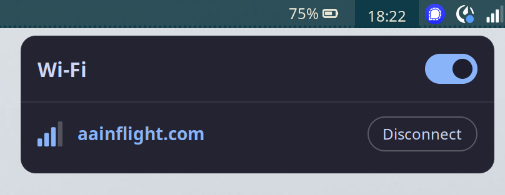

# wayman

A small Wi-Fi tray tool for sway and other wlroots compositors, written in
Zig 0.17. It puts a signal-strength icon in the bar's tray and opens a popup
for switching networks, joining new ones and disconnecting.



## How it works

- **Tray icon**: a `StatusNotifierItem` on the session bus. Any bar with a
  StatusNotifier host (waybar's `tray` module, for example) shows it. The
  icon is drawn with cairo and updated as the signal changes; the tooltip
  shows the connected network and strength.
- **Popup**: a `wlr-layer-shell` surface anchored below the bar at the top
  right, drawn with cairo and pango. Click the tray icon to open it. Click a
  network to join it, type the password when asked, press Escape or click
  anywhere outside to close it.
- **Networking**: NetworkManager over its D-Bus API, using libdbus-1. New
  networks are added with `AddAndActivateConnection`; on Ubuntu,
  NetworkManager's netplan integration persists them as
  `/etc/netplan/90-NM-*.yaml`. Wrong passwords remove the half-made profile
  again so the next attempt prompts afresh.

Supported networks: open, WPA2/WPA3 personal, OWE. Enterprise (802.1X) and
WEP networks are listed but need a profile created with netplan or `nmcli`
first; once one exists wayman can activate it.

## Building

```
nix develop      # or provide zig 0.17, pkg-config, wayland-scanner and the libs below
zig build
./zig-out/bin/wayman
```

Dependencies: wayland-client, wayland-cursor, wayland-protocols,
libxkbcommon, cairo, pango, dbus-1. The protocol XML files wayman needs are
vendored in `protocols/`.

`zig build test` runs the unit tests. `nix build` produces the package.

## Running

Start it from your sway config:

```
exec wayman
```

and make sure your bar has a tray, e.g. `"modules-right": ["tray", ...]` in
waybar. Logs go to stderr; debug builds are more verbose.

## Layout

| File           | Role                                                        |
| -------------- | ----------------------------------------------------------- |
| `src/main.zig` | Wires everything together and runs the poll loop           |
| `src/nm.zig`   | NetworkManager client and the network model                 |
| `src/sni.zig`  | StatusNotifierItem D-Bus object                             |
| `src/wl.zig`   | Wayland connection, input, shm buffers, layer-shell popup   |
| `src/ui.zig`   | Popup layout, drawing and interaction                       |
| `src/icon.zig` | Cairo drawing helpers and tray pixmap rendering             |
| `src/dbus.zig` | Thin helpers over libdbus-1                                 |
| `src/c.h`      | The C headers translated into the `c` module at build time  |
